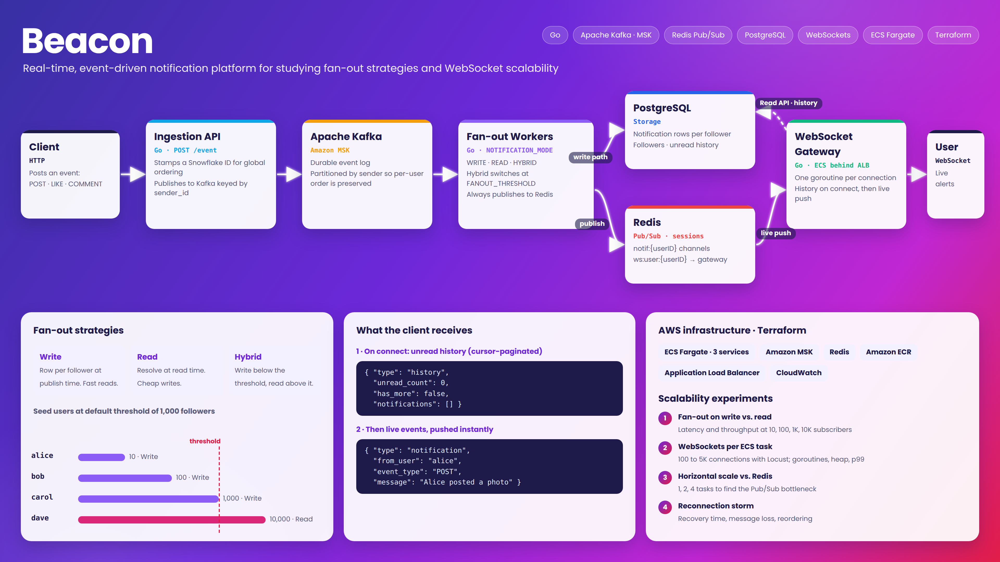
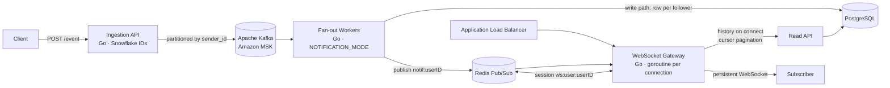

# Beacon

**Real-time, event-driven notification platform for studying fan-out strategies and WebSocket scalability at scale.**

When a user triggers an event (a like, a follow, a post), every relevant subscriber receives a push notification in real time over a persistent WebSocket connection. No polling, no intentional delay.

Beacon is built as a research platform: every layer is instrumented for benchmarking so the team can measure how fan-out strategy, connection count, and horizontal scaling affect latency and throughput in a realistic notification system.



---

## Table of Contents

1. [Highlights](#highlights)
2. [Architecture](#architecture)
3. [How an Event Becomes a Notification](#how-an-event-becomes-a-notification)
4. [Components](#components)
5. [Fan-out Strategies](#fan-out-strategies)
6. [Ordering and Delivery Guarantees](#ordering-and-delivery-guarantees)
7. [Message Formats](#message-formats)
8. [Technology Stack](#technology-stack)
9. [Repository Structure](#repository-structure)
10. [Local Setup](#local-setup)
11. [AWS Deployment](#aws-deployment)
12. [Testing End to End](#testing-end-to-end)
13. [Seed Data](#seed-data)
14. [Experiments](#experiments)
15. [Design Decisions and Tradeoffs](#design-decisions-and-tradeoffs)
16. [Scope and Limitations](#scope-and-limitations)

---

## Highlights

- **Event-driven core.** Events flow through Apache Kafka, decoupling producers from delivery so each side scales independently.
- **Three fan-out strategies in one codebase.** Fan-out on write, fan-out on read, and a hybrid mode that switches between them based on follower count, selected with a single environment variable.
- **Global ordering.** Every event is stamped with a Snowflake ID, and Kafka partitions by sender so per-user ordering is preserved.
- **Real-time delivery.** A Go WebSocket gateway runs one goroutine per connection and pushes notifications the moment they arrive on the recipient's Redis Pub/Sub channel.
- **History on connect.** New connections receive unread notification history from PostgreSQL with cursor-based pagination before live events begin.
- **Infrastructure as code.** The full AWS stack (ECS Fargate, Amazon MSK, Redis, ECR, Application Load Balancer) is defined in Terraform, so every teammate can deploy an independent environment.
- **Built for measurement.** Load testing with Locust and monitoring with CloudWatch drive four scalability experiments.

---

## Architecture



| Layer | Responsibility |
|---|---|
| Event Ingestion API (Go) | Accepts `POST /event`, assigns Snowflake IDs for global ordering, publishes to Kafka partitioned by sender ID |
| Apache Kafka (Amazon MSK) | Durable event log that decouples ingestion from fan-out |
| Fan-out Workers (Go) | Consume Kafka and apply the fan-out strategy selected by `NOTIFICATION_MODE` |
| PostgreSQL | Notification rows (write path), follower relationships, and unread history |
| Redis | Pub/Sub channels for cross-instance delivery and session keys mapping users to gateway instances |
| WebSocket Gateway (Go) | Holds one persistent connection per user, delivers history on connect and live events via Redis |
| Read API | Serves unread notification history from PostgreSQL with cursor-based pagination |

---

## How an Event Becomes a Notification

1. **Ingest.** A client posts an event (`POST`, `LIKE`, or `COMMENT`) to the Ingestion API.
2. **Stamp and order.** The API assigns a Snowflake ID, giving every event a globally sortable identifier.
3. **Publish.** The event is published to Kafka, partitioned by `sender_id`, so all events from one user stay in order.
4. **Fan out.** Fan-out workers consume the topic and, depending on `NOTIFICATION_MODE`:
   - **Write path:** insert a notification row into PostgreSQL for every follower.
   - **Read path:** skip the per-follower writes and resolve notifications with a query at read time.
   - **Hybrid:** choose write or read per sender based on follower count versus `FANOUT_THRESHOLD`.
5. **Notify.** Regardless of path, workers publish to the recipient's Redis Pub/Sub channel, `notif:{userID}`.
6. **Deliver.** The WebSocket Gateway holding that user's connection receives the message and pushes it over the socket immediately.
7. **Catch up on connect.** When a user first connects, the gateway fetches unread history from PostgreSQL through the Read API and sends it as a `history` envelope before any live events.

---

## Components

### Event Ingestion API (Go)
- Single entry point for all events via `POST /event`
- Generates Snowflake IDs so events can be ordered globally without a central counter
- Uses `sender_id` as the Kafka partition key to preserve per-user ordering

### Fan-out Workers (Go)
- Kafka consumers that turn one event into notifications for every subscriber
- Strategy controlled by `NOTIFICATION_MODE`: `FAN_OUT_WRITE`, `FAN_OUT_READ`, or `FAN_OUT_HYBRID`
- Hybrid mode compares a sender's follower count with `FANOUT_THRESHOLD` (default 1,000)
- Always publish to Redis Pub/Sub so online users are notified in real time

### Redis
- **Pub/Sub channels** `notif:{userID}` carry notifications to whichever gateway instance holds the user's connection
- **Session keys** `ws:user:{userID}` map each connected user to a gateway instance, enabling cross-instance delivery

### WebSocket Gateway (Go)
- One goroutine per connection, keeping per-connection overhead low
- Subscribes to the user's Redis channel and pushes notifications as they arrive
- Sends unread history on connect with cursor-based pagination
- Runs behind an Application Load Balancer on ECS Fargate

### PostgreSQL
- Stores follower relationships, notification rows for the write path, and unread history

Topic names, Kafka message shapes, consumer configuration, and Redis channels are specified in [`CONTRACTS.md`](CONTRACTS.md).

---

## Fan-out Strategies

| Strategy | How it works | Strength | Cost |
|---|---|---|---|
| Fan-out on write | One notification row per follower at publish time | Fast reads, history is precomputed | Expensive for senders with many followers |
| Fan-out on read | Notifications resolved by query when a user reads | Cheap writes, no per-follower amplification | Heavier read queries |
| Hybrid | Write path below `FANOUT_THRESHOLD`, read path above it | Balances write amplification and read cost | Two code paths to maintain |

The hybrid mode mirrors how large social platforms handle high-follower accounts: precompute for typical users, defer for very popular ones.

---

## Ordering and Delivery Guarantees

- **Global ordering:** Snowflake IDs make every event sortable across the system.
- **Per-user ordering:** Kafka partitioning by `sender_id` keeps each sender's events in sequence.
- **Cross-instance delivery:** Redis Pub/Sub lets any worker reach a user regardless of which gateway instance holds the connection.
- **Missed messages:** History on connect, served from PostgreSQL, covers notifications that arrived while a user was offline.

---

## Message Formats

On connect, the gateway sends history first:

```json
{ "type": "history", "unread_count": 0, "has_more": false, "notifications": [] }
```

Live notifications follow as events are posted:

```json
{ "type": "notification", "id": "...", "from_user": "alice", "event_type": "POST", "message": "Alice posted a photo", "timestamp": "..." }
```

Valid event types: `POST`, `LIKE`, `COMMENT` (case-sensitive).

---

## Technology Stack

| Area | Technology |
|---|---|
| Services | Go (Ingestion API, Fan-out Workers, WebSocket Gateway) |
| Messaging | Apache Kafka (Amazon MSK in AWS) |
| Real-time delivery | WebSockets, Redis Pub/Sub |
| Storage | PostgreSQL, Redis |
| IDs and ordering | Snowflake IDs, Kafka partitioning |
| Containers | Docker, Docker Compose, Amazon ECR |
| Compute | Amazon ECS on Fargate |
| Networking | Application Load Balancer |
| Infrastructure as code | Terraform (>= 1.3.0) |
| Load testing and monitoring | Locust, Amazon CloudWatch |

---

## Repository Structure

```
.
├── ingestion/            # Event Ingestion API (Go) + Dockerfile
├── fanout/               # Fan-out workers (Go) + Dockerfile, with its own README
├── gateway/              # WebSocket Gateway (Go) + Dockerfile
├── readapi/              # Read API for notification history (Go) + Dockerfile
├── infra/                # Terraform for the full AWS stack
├── loadtest/             # Load-testing harness and test plan
├── migrations/           # SQL migrations
├── db/                   # Database init
├── docker-compose.yml    # Local stack: Redis, Kafka, fan-out workers
├── CONTRACTS.md          # Kafka topics, message shapes, Redis channels
└── README.md
```

---

## Local Setup

Requires Docker and Docker Compose v2. From the repository root:

```bash
docker compose up --build
```

This starts Redis, Kafka, and the fan-out workers. The first Kafka boot can take about a minute. To exercise the fan-out path in detail, with optional test services, an HTTP producer, and a Redis subscriber, see [`fanout/README.md`](fanout/README.md).

---

## AWS Deployment

All infrastructure lives in Terraform under `infra/`, and each teammate can deploy an independent stack in their own AWS account.

### Prerequisites
- Terraform >= 1.3.0
- AWS CLI configured
- Docker Desktop running
- `wscat` for testing: `npm install -g wscat`

### Account notes
- **Sandbox account:** full access, including Amazon MSK and IAM role creation. Use it for development and experiments.
- **Learner Lab account:** MSK and custom IAM roles are blocked, so use Docker Compose locally instead.

### 1. Configure credentials

```bash
aws configure   # region: us-east-1
```

For Learner Lab, paste the temporary credentials from "AWS Details" into `~/.aws/credentials`.

### 2. Deploy infrastructure

```bash
cd infra
terraform init
terraform plan
terraform apply -auto-approve   # MSK takes 15 to 25 minutes
```

Note these outputs:
- `alb_dns`: WebSocket endpoint for clients
- `ecr_gateway_url`, `ecr_ingestion_url`, `ecr_fanout_url`: image repositories
- `kafka_bootstrap_brokers`, `redis_endpoint`: injected automatically into ECS tasks

### 3. Build and push images

```bash
aws ecr get-login-password --region us-east-1 \
  | docker login --username AWS --password-stdin ACCOUNT_ID.dkr.ecr.us-east-1.amazonaws.com

docker buildx build --platform linux/amd64 --load -t notif-system-gateway -f gateway/Dockerfile .
docker buildx build --platform linux/amd64 --load -t notif-system-ingestion -f ingestion/Dockerfile .
docker buildx build --platform linux/amd64 --load --target worker -t notif-system-fanout -f fanout/Dockerfile .
# tag and push each image to its ECR repository
```

> **Apple Silicon:** `--platform linux/amd64` is required. Without it Docker builds an ARM image that ECS Fargate cannot run.

### 4. Deploy services

```bash
aws ecs update-service --cluster notif-system-cluster --service notif-system-gateway --force-new-deployment --region us-east-1
aws ecs update-service --cluster notif-system-cluster --service notif-system-ingestion --force-new-deployment --region us-east-1
aws ecs update-service --cluster notif-system-cluster --service notif-system-fanout --force-new-deployment --region us-east-1
aws ecs list-tasks --cluster notif-system-cluster --region us-east-1
```

### 5. Tear down

```bash
cd infra
terraform destroy   # MSK takes a few minutes to delete
```

Always destroy the stack after testing to avoid unnecessary AWS charges.

---

## Testing End to End

```bash
# Terminal 1: connect a WebSocket client
wscat -c "ws://YOUR_ALB_DNS:8080/ws?user_id=alice"

# Terminal 2: post an event within 60 seconds
curl -X POST http://INGESTION_TASK_IP:3000/event \
  -H "Content-Type: application/json" \
  -d '{"type":"POST","from_user":"alice","detail":"Alice posted a photo"}'
```

Expected: a `history` envelope on connect, followed by real-time `notification` messages as events are posted.

---

## Seed Data

The database is preloaded with follower relationships designed to exercise each fan-out path:

| User | Followers | Follower IDs | Path at default threshold (1,000) |
|---|---|---|---|
| alice | 10 | `follower_a_1` to `follower_a_10` | Write |
| bob | 100 | `follower_b_1` to `follower_b_100` | Write |
| carol | 1,000 | `follower_c_1` to `follower_c_1000` | Write (at threshold) |
| dave | 10,000 | `follower_d_1` to `follower_d_10000` | Read |

To test history, connect as a follower (for example `follower_a_1`) and post an event as the matching user (`alice`).

---

## Experiments

| # | Experiment | What is measured |
|---|---|---|
| 1 | Fan-out on write vs. read | Latency and publisher throughput at 10, 100, 1K, and 10K subscribers; the crossover point and Amdahl-style sequential fan-out limits |
| 2 | WebSockets per ECS task | Concurrent connections scaled from 100 to 5K with Locust, tracking goroutines, heap, CloudWatch metrics, and p99 latency |
| 3 | Horizontal scale vs. Redis | Fixed total connections across 1, 2, and 4 ECS tasks, finding when Redis Pub/Sub becomes the shared bottleneck |
| 4 | Reconnection storm (stretch) | Mass disconnect and reconnect, measuring recovery time, message loss, and reordering |

---

## Design Decisions and Tradeoffs

| Decision | Chosen | Over | Why | Cost |
|---|---|---|---|---|
| Event transport | Kafka | Direct service calls | Decouples ingestion from fan-out and absorbs bursts | An extra system to operate |
| Partition key | `sender_id` | Random partitioning | Preserves per-user ordering | Hot partitions for very active senders |
| Fan-out | Configurable write, read, or hybrid | One fixed strategy | Makes strategies directly comparable in experiments | Multiple code paths |
| Cross-instance delivery | Redis Pub/Sub | Sticky routing only | Any worker can reach any connected user | Redis becomes a shared dependency, measured in Experiment 3 |
| Connection model | One goroutine per connection | Thread pools | Lightweight concurrency in Go | Memory grows with connection count, measured in Experiment 2 |
| Infrastructure | Terraform | Manual console setup | Reproducible, independent stacks per teammate | Long MSK provisioning times |

---

## Scope and Limitations

Beacon is intentionally instrumented for benchmarking rather than hardened for production. It focuses on the behavior of fan-out, connection scaling, and shared-state bottlenecks, and leaves production hardening out of scope.
